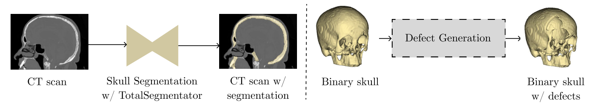
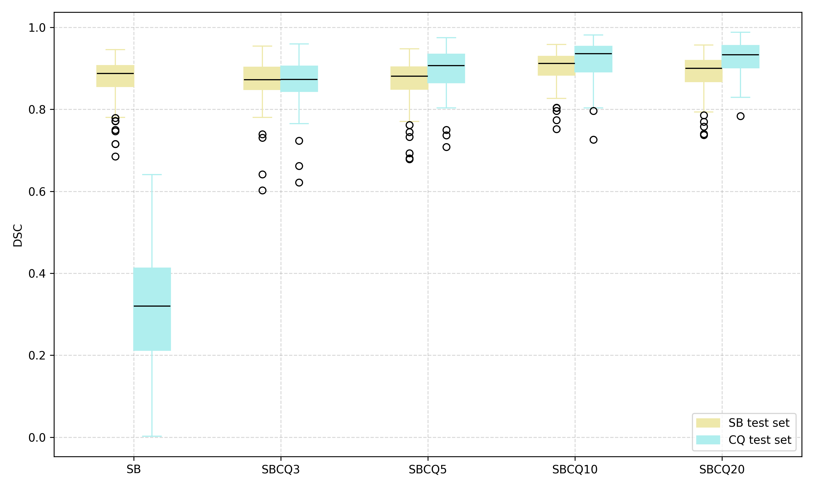
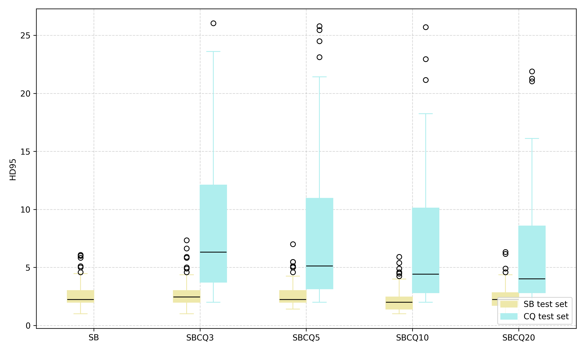
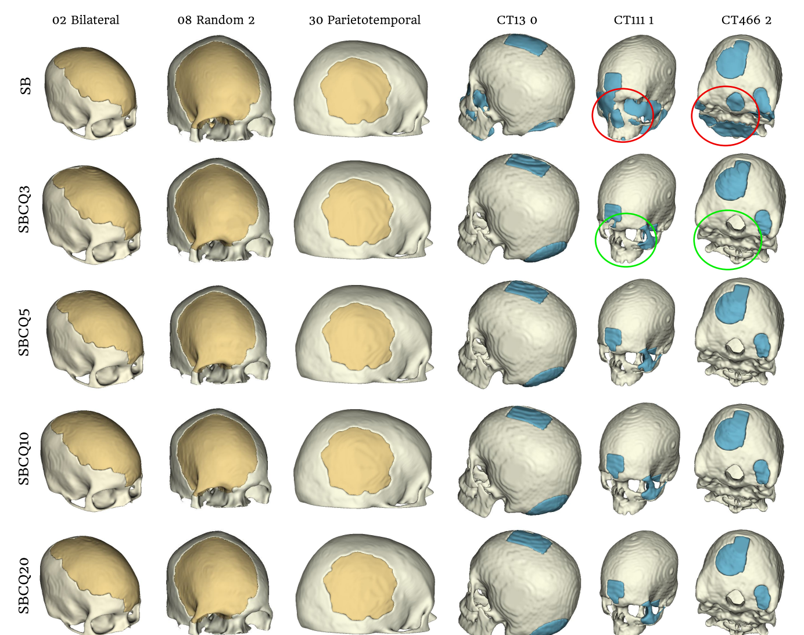
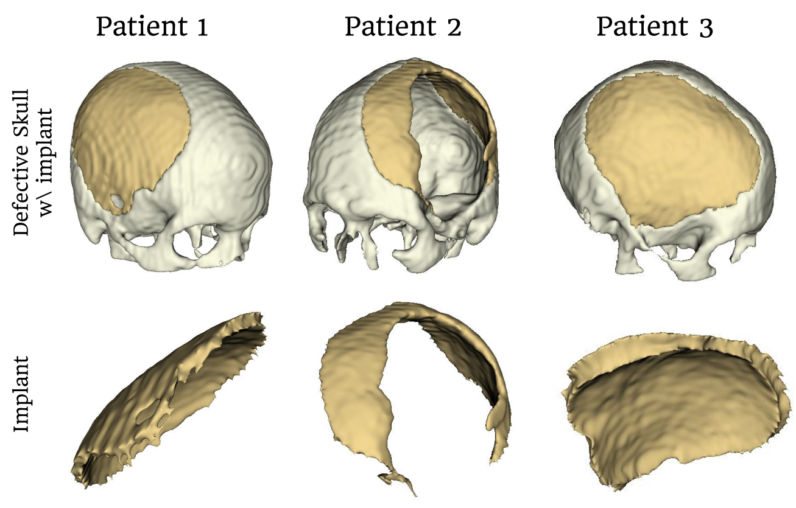

# CranioImpInp: From CT to Clinical Cranioplasty Inpainting using a Conditional Wavelet Diffusion Model
[](LICENSE)

This repository contains the code for the paper **From CT to Clinical Cranioplasty Inpainting using a Conditional Wavelet Diffusion Model** by Ricardo Coimbra Brioso, Florentin Bieder and Philippe C. Cattin, published in the MICCAI 2026 COLAS workshop proceedings.

CranioImpInp is an end-to-end pipeline for AI-assisted cranial implant design. It turns standard, **non-defective head CT scans** into training data for skull inpainting, and uses that data to train a 3D Conditional Wavelet Diffusion Model (cWDM) that generates the implant for a defective skull.

## Overview

<p align="center">
    
</p>

1. **Skull segmentation.** Raw head CT scans are segmented with the open-weights [TotalSegmentator](https://github.com/wasserth/TotalSegmentator) model to get a binary skull.
2. **Defect generation.** A rule-based algorithm injects realistic, diverse defects into the binary skulls. Each defect is a sphere or rectangular block centred on a randomly sampled skull voxel. Its mask is smoothed with a morphological opening and elastically deformed, and up to three smaller defects can be added along its border. Each skull gets several defective versions with up to *n* defects each. The difference between the original and the defective skull is the ground-truth implant.
3. **Implant inpainting.** A [cWDM](https://github.com/pfriedri/cwdm) is trained on pairs of complete and defective skulls. Both volumes are decomposed with a 3D discrete Haar wavelet transform, so the diffusion model works on 8 × D/2 × H/2 × W/2 wavelet coefficients. This keeps 3D training affordable without a pretrained autoencoder.
4. **Post-processing.** The predicted skull is subtracted from the defective input to get the implant. The implant is then cleaned and exported as a surface mesh (STL) for surgical planning.

## Results

We trained one baseline on SkullBreak only (**SB**) and four models on SkullBreak plus the augmented CQ500 dataset, with 3, 5, 10 and 20 generated defective skulls per patient (**SBCQ3**, **SBCQ5**, **SBCQ10**, **SBCQ20**). All models were evaluated on the SkullBreak (SB) and CQ500 (CQ) test sets.

| Model  | DSC (SB test) | DSC (CQ test) | HD95 in mm (SB test) | HD95 in mm (CQ test) |
|--------|:-------------:|:-------------:|:--------------------:|:--------------------:|
| SB     | 0.876 ± 0.048 | 0.305 ± 0.144 | 2.55 ± 0.95 | 105.66 ± 29.88 |
| SBCQ3  | 0.870 ± 0.051 | 0.862 ± 0.063 | 2.65 ± 1.06 | 18.56 ± 30.43 |
| SBCQ5  | 0.869 ± 0.052 | 0.891 ± 0.056 | 2.57 ± 1.01 | 15.42 ± 25.97 |
| SBCQ10 | **0.903 ± 0.037** | 0.919 ± 0.050 | **2.16 ± 0.86** | 8.83 ± 15.47 |
| SBCQ20 | 0.889 ± 0.043 | **0.927 ± 0.040** | 2.38 ± 0.91 | **6.31 ± 4.97** |

The baseline trained only on SkullBreak does not generalize to the CQ500 domain. Adding generated defects from CQ500 fixes this, and the gains level off at around 10–20 defects per skull. The per-case metrics are in [`skull_segmentation/`](skull_segmentation) (`<model>_<test set>.csv`) and the summaries are in `metrics_summary_DSC.csv` and `metrics_summary_HD95.csv`.

<p align="center">
    
    
</p>

<p align="center"><em>DSC (left) and HD95 (right) per model on the SkullBreak (yellow) and CQ500 (blue) test sets. The SB baseline's HD95 values on CQ500 are left out of the plot because they are far off the scale.</em></p>

<p align="center">
    
</p>

<p align="center"><em>Implants generated by each model. Yellow: SkullBreak test cases. Blue: CQ500 test cases. The SB model wrongly fills cavities such as the orbits and nasal cavity (red circles). Adding just a few generated defects from CQ500 fixes this (green circles).</em></p>

### Clinical cases
We also applied the full pipeline to three real patients with traumatic brain injury who had part of their skull removed. Their CT scans were segmented with TotalSegmentator, and the binary skulls were given to the SBCQ20 model. The implants for Patients 1 and 3 fill the defect completely and are a good starting point for the implant designer. For Patient 2, the model finds the defect but does not fill all of it.

<p align="center">
    
</p>

<p align="center"><em>Real defective skulls with the generated implant (top) and the implant on its own (bottom).</em></p>

## Repository structure

```
├── run.sh                      # training / sampling entry point (set hyperparameters here)
├── scripts/
│   ├── train.py                # cWDM training
│   └── sample.py               # cWDM inference (inpainting)
├── guided_diffusion/           # diffusion model, U-Net and training loop (adapted from WDM)
│   ├── skullbreakerloader.py   # dataset of (complete skull, defective skull) pairs
│   └── prepare_skullbreaker.py # builds the SkullBreak CSV file and train/test split
├── DWT_IDWT/                   # 3D discrete wavelet transform layers
├── skull_segmentation/
│   ├── prepareCQ500.py                  # CQ500 filtering and CSV creation
│   ├── predict_totalSegmentator.py      # skull segmentation with TotalSegmentator
│   ├── prepare_totalsegmentator_dataset.py
│   ├── defect_generation.py             # synthetic defect generation algorithm
│   ├── defect_analysis.py               # statistics on the generated defects
│   ├── prepare_clinical_data.py         # DICOM -> NIfTI conversion and resampling of clinical cases
│   ├── skull_implant_post_processing.py # implant cleaning and STL export
│   └── visualizations_statistical.py    # box plots and paired t-tests
├── eval/
│   ├── eval_skullbreak.py      # DSC / HD95 on the SkullBreak test set
│   └── eval_cq500.py           # DSC / HD95 on the CQ500 test set
└── skullbreak_{train,test}_*.csv  # SkullBreak patient split
```

## Installation
We recommend using a [conda](https://github.com/conda-forge/miniforge) environment:
```sh
mamba env create -f environment.yml
mamba activate wdm
```
Skull segmentation also needs [TotalSegmentator](https://github.com/wasserth/TotalSegmentator) (`pip install TotalSegmentator`).

## Data
* **SkullBreak** ([Kodym et al., 2021](https://doi.org/10.1016/j.dib.2021.106902)): 114 skulls derived from CQ500, each with five synthetic defects (bilateral, fronto-orbital, parieto-temporal and two random). It was released as part of the [AutoImplant 2021 challenge](https://autoimplant2021.grand-challenge.org/).
* **CQ500** ([Chilamkurthy et al., 2018](http://headctstudy.qure.ai/dataset)): 491 head CT scans from several scanners and protocols. After removing scans with severe artifacts, registration failures, resolution mismatches or incomplete skull coverage, we used **200 scans**.

Neither dataset is included in this repository. Please download them from their original sources. The clinical CT scans are not distributed.

The data loader reads a CSV file in the dataset directory with one row per (complete skull, defective skull) pair:
```
image_path,missing_path,mode
<dataset>/complete_skulls/CT001.nii.gz,<dataset>/defected_skulls/CT001_0.nii.gz,train
...
```
`mode` is `train`, `test` or `clinical`. `skull_segmentation/prepareCQ500.py` and `guided_diffusion/prepare_skullbreaker.py` generate these files.

## Usage

### 1. Segment and augment CQ500
1. Convert the CQ500 DICOM scans to NIfTI and resample them (`skull_segmentation/prepareCQ500.py`, `skull_segmentation/prepare_clinical_data.py`).
2. Segment the skulls with TotalSegmentator (`skull_segmentation/predict_totalSegmentator.py`).
3. Generate the defective skulls and implants (`skull_segmentation/defect_generation.py`). Set `num_defect_skulls` to the number of defective versions per patient, e.g. 3, 5, 10 or 20.
4. Build the training CSV (`create_csv_dataset_filepaths` in `skull_segmentation/prepareCQ500.py`).

Input and output folders are set at the bottom of each script (`if __name__ == "__main__":`).

### 2. Train and sample the cWDM
Set `MODE` (`train` or `sample`), `DATA_DIR`, `GPU` and the checkpoint settings in `run.sh`, then run:
```sh
bash run.sh
```
We used a U-Net with 64 base channels, channel multipliers `1,2,4,8,8`, 1000 diffusion steps with a linear noise schedule, `x0` prediction, and volumes of 256³ voxels. Training writes checkpoints to `runs/`, and sampling writes the predicted skulls to `results/`.

### 3. Evaluate and post-process
* `eval/eval_skullbreak.py` and `eval/eval_cq500.py` extract the implant from each prediction and compute DSC and HD95.
* `skull_segmentation/visualizations_statistical.py` makes the box plots and paired t-test matrices.
* `skull_segmentation/skull_implant_post_processing.py` cleans the predicted implants and exports them as STL meshes.

## Citation
If you use this code, please cite our paper and the WDM paper it builds on:
```bibtex
@inproceedings{brioso2026cranioimpinp,
  title     = {From CT to Clinical Cranioplasty Inpainting using a Conditional Wavelet Diffusion Model},
  author    = {Coimbra Brioso, Ricardo and Bieder, Florentin and Cattin, Philippe C.},
  booktitle = {Medical Image Computing and Computer Assisted Intervention -- MICCAI 2026 Workshops (COLAS)},
  year      = {2026}
}

@inproceedings{friedrich2024wdm,
  title     = {WDM: 3D Wavelet Diffusion Models for High-Resolution Medical Image Synthesis},
  author    = {Friedrich, Paul and Wolleb, Julia and Bieder, Florentin and Durrer, Alicia and Cattin, Philippe C.},
  booktitle = {Deep Generative Models (DGM4MICCAI 2024)},
  year      = {2024},
  doi       = {10.1007/978-3-031-72744-3_2}
}
```

## Acknowledgements
This work was financially supported by the Werner Siemens Foundation through the MIRACLE II project.

This code is based on [WDM: 3D Wavelet Diffusion Models](https://github.com/pfriedri/wdm-3d) by Paul Friedrich et al. (MIT License). WDM in turn builds on:
* https://github.com/openai/guided-diffusion (published under [MIT License](https://github.com/openai/guided-diffusion/blob/main/LICENSE))
* https://github.com/FlorentinBieder/PatchDDM-3D (published under [MIT License](https://github.com/FlorentinBieder/PatchDDM-3D/blob/master/LICENSE))
* https://github.com/VinAIResearch/WaveDiff (published under [GNU General Public License v3.0](https://github.com/VinAIResearch/WaveDiff/blob/main/LICENSE))
* https://github.com/LiQiufu/WaveCNet (published under [CC BY-NC-SA 4.0 License](https://creativecommons.org/licenses/by-nc-sa/4.0/legalcode)). The code in `DWT_IDWT/` comes from this repository and stays under that license.

Skull segmentation uses [TotalSegmentator](https://github.com/wasserth/TotalSegmentator) (Wasserthal et al., 2023).
